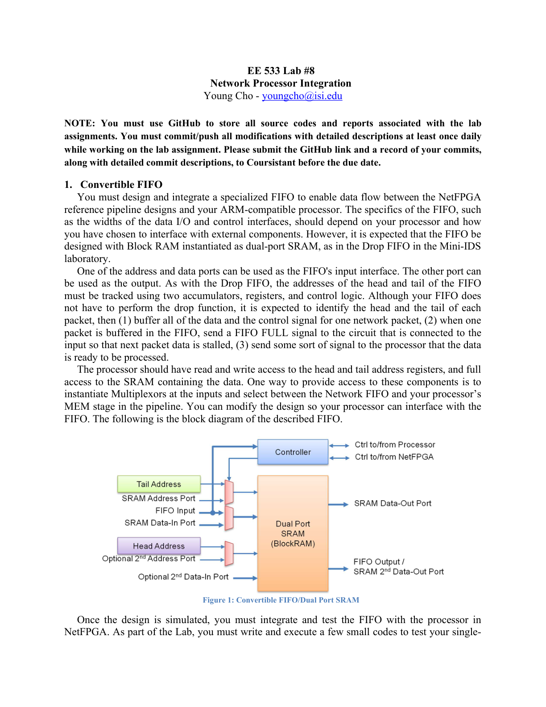
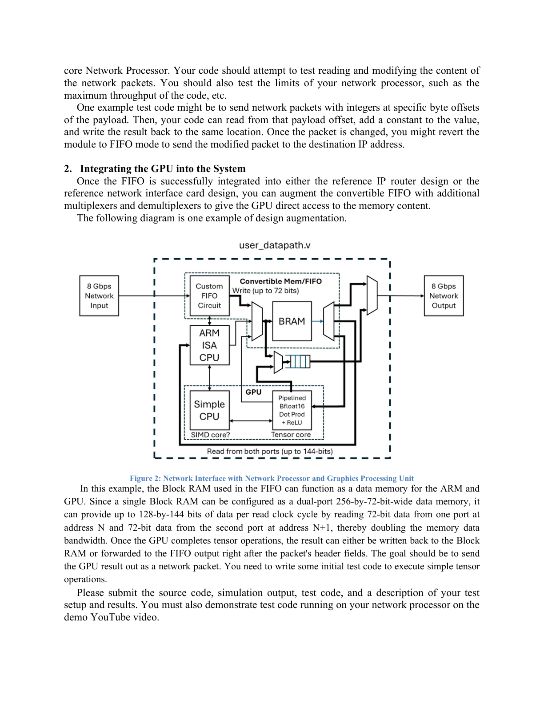

# EE 533 Lab #8: Network Processor Integration

## 1. Convertible FIFO

You must design and integrate a specialized FIFO to enable data flow between the NetFPGA reference pipeline designs and your ARM-compatible processor.

The FIFO interface details (e.g., data I/O width and control interface width) depend on your processor and your chosen external interface. However, the FIFO is expected to be designed with **Block RAM instantiated as a dual-port SRAM**, similar to the Drop FIFO in the Mini-IDS lab.

### Expected FIFO behavior / requirements

- Use one address/data port as the FIFO **input** interface, and the other port as the **output**.
- Track FIFO **head** and **tail** addresses using two accumulators, registers, and control logic (similar to the Drop FIFO).
- Your FIFO does **not** need to perform a drop function, but it is expected to:
  1. Identify the **head** and **tail** of each packet.
  2. Buffer **all data + control signals** for **one** network packet.
  3. When one packet is buffered, assert a **FIFO FULL** signal to stall the next packet at the input.
  4. Send some signal to the processor indicating the data is ready to be processed.

### Processor access expectations

- The processor should have **read/write access** to the head and tail address registers.
- The processor should have **full access** to the SRAM that stores the packet data.
- One suggested approach is to instantiate **MUXes** at the inputs and select between the Network FIFO and your processor’s **MEM stage** in the pipeline (or modify the design equivalently so the processor can interface with the FIFO).

### Figure 1: Convertible FIFO / Dual Port SRAM

### Integration & testing (NetFPGA)

After simulation, you must integrate and test the FIFO with the processor in NetFPGA. As part of the lab, you must write and run a few small programs to test your single-core Network Processor:

- Test reading and modifying network packet contents.
- Test limits such as the maximum throughput of your code.

**Example test idea:** send packets that contain integers at specific payload byte offsets. Your code reads the integer at that offset, adds a constant, writes back to the same location, then switches the module back to FIFO mode to forward the modified packet to the destination IP.

---

## 2. Integrating the GPU into the System

Once the FIFO is successfully integrated into either the reference **IP router** design or the reference **network interface card** design, you can augment the convertible FIFO with additional multiplexers/demultiplexers to give the GPU direct access to the memory content.

### Figure 2: Network Interface with Network Processor and GPU

### Bandwidth note (example)

In the example, the FIFO Block RAM can also function as a shared data memory for the ARM and GPU. If a single Block RAM is configured as a **dual-port 256×72-bit** memory, it can provide up to **128×144 bits per read clock cycle** by reading 72 bits from one port at address *N* and 72 bits from the second port at address *N+1*, effectively doubling memory bandwidth.

After the GPU completes tensor operations, the result can be:
- written back to Block RAM, or
- forwarded directly to the FIFO output right after the packet header fields.

The goal is to send the GPU result out as a network packet. You need to write initial test code to execute simple tensor operations.

---

## Submission

Submit:
- source code
- simulation output
- test code
- description of your test setup and results

You must also demonstrate test code running on your network processor in the demo YouTube video.
